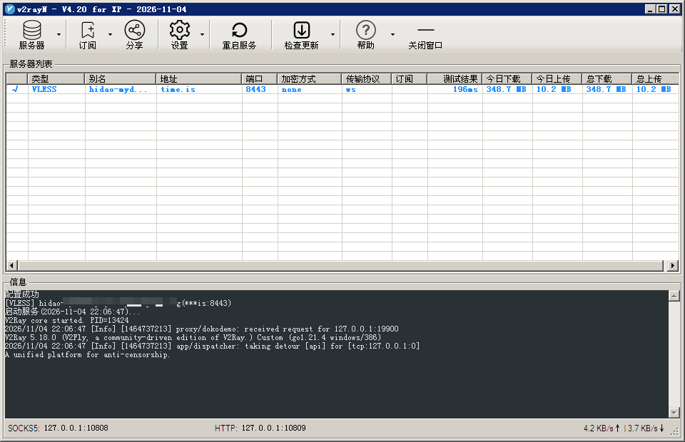
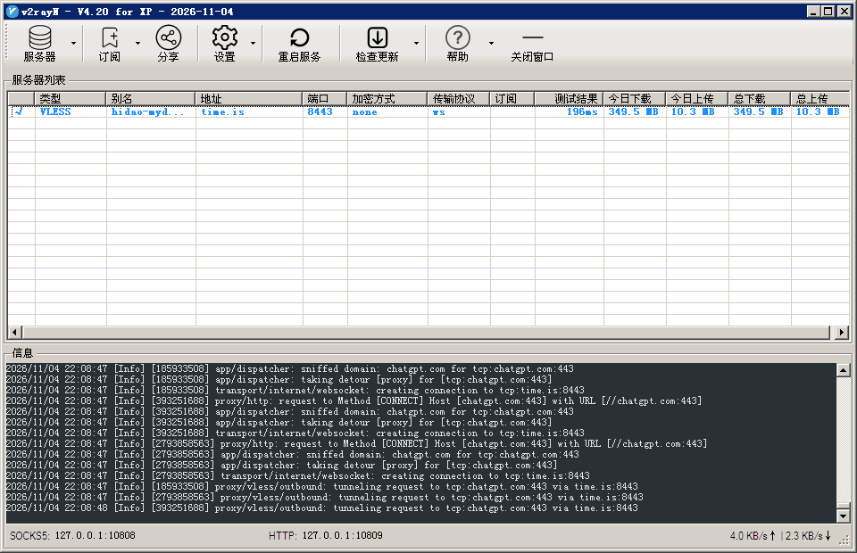

# v2rayN v4.20 for XP

### How to use
- Download v2rayN.zip from release
- Download v2ray-core or xray-core and geo rules, put v2ray.exe、xray.exe、geoip.dat、geosite.dat in v2rayn folder
- Run v2rayN.exe

 
 

### Requirements  
- Microsoft .NET Framework 4.0 for XP
- v2ray-core、xray-core for XP [https://github.com/ihidao/v2ray-core_xray-core_for_XP](https://github.com/ihidao/v2ray-core_xray-core_for_XP)
